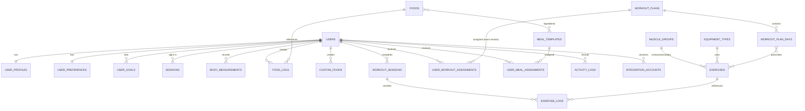

# Database schema (MongoDB)

Separate collections per concern; no large all-in-one user document. MongoDB references are
*logical* — the backend validates references, ownership and delete rules itself.

Legend: ✅ model + API built · 📐 designed, model added in its phase.

## Users & auth

| Collection | Status | Key fields | Indexes |
|---|---|---|---|
| `users` | ✅ | name, email, passwordHash (select:false), role `ADMIN\|USER\|TRAINER`, status `ACTIVE\|DEACTIVATED`, onboardingCompleted, lastLoginAt, passwordChangedAt | email (unique), {role,status}, createdAt |
| `userProfiles` | ✅ | userId, dateOfBirth (`YYYY-MM-DD`), heightCm, sex, activityLevel, trainingExperience | userId (unique) |
| `userGoals` | ✅ | userId, goalType, targetWeightKg, targetBodyFatPercent, startDate, endDate, status `ACTIVE\|ENDED` | {userId,startDate}, **one ACTIVE goal per user** (partial unique) |
| `userPreferences` | ✅ | userId, units, timezone, notifications{…}, **sharing{shareProgressWithAdmin, shareNutritionWithAdmin}** (default off) | userId (unique) |
| `sessions` | ✅ | userId, familyId, refreshTokenHash, clientType, userAgent, ip, expiresAt, revokedAt, revokedReason, replacedBy | refreshTokenHash (unique), familyId, **TTL on expiresAt** |
| `passwordResets` | ✅ | userId, tokenHash, expiresAt, usedAt | tokenHash (unique), TTL on expiresAt |

Body values that change (weight, waist, body fat) are **not** on the profile — they are `bodyMeasurements`, so history is never overwritten. The onboarding assessment writes the first measurement.

## Exercises

| Collection | Status | Key fields |
|---|---|---|
| `muscleGroups` | ✅ | name, slug (unique), description, status |
| `equipmentTypes` | ✅ | name, slug (unique), description, status |
| `exercises` | ✅ | code (unique, upper-case), name, primaryMuscleId, secondaryMuscleIds[], equipmentId, exerciseType, movementPattern, instructions[], mediaUrl (https only), defaultSets, defaultRepMin, defaultRepMax, defaultRestSeconds, notes, status, archivedAt, createdBy, updatedBy |

Exercise categorisation uses `exerciseType` + `movementPattern` enums plus the two lookup collections; a separate `exerciseCategories` collection was not needed.

## Workouts (versioned)

| Collection | Status | Key fields |
|---|---|---|
| `workoutPlans` | ✅ | **planKey** (stable across versions), **version**, **isLatest**, name, description, goalType, experienceLevel, durationWeeks, daysPerWeek, warmUpInstructions, status `DRAFT\|PUBLISHED\|ARCHIVED`, publishedAt — unique {planKey, version} |
| `workoutPlanDays` | ✅ | workoutPlanId (one version), dayNumber, weekday, dayName, exercises[{exerciseId, exerciseNameSnapshot, order, sets, repMin, repMax, restSeconds, notes}] |
| `userWorkoutAssignments` | ✅ | userId, workoutPlanId, **planVersion**, startDate, endDate, status, assignedBy |
| `workoutSessions` | ✅ | userId, assignmentId, workoutPlanId, workoutPlanDayId, title, startedAt, completedAt, pausedAt, pausedSeconds, durationSeconds, **summary** {duration, volume, sets, reps, personalRecords}, status `IN_PROGRESS\|PAUSED\|COMPLETED\|DISCARDED`, notes |
| `exerciseLogs` | ✅ | workoutSessionId, userId, exerciseId, **exerciseNameSnapshot**, order, **planned** {sets, repMin, repMax, restSeconds}, sets[{setNumber, weightKg, reps, setType `WARM_UP\|WORKING\|DROP\|FAILURE`, completed, rpe}], notes, discomfort{reported, location, severity, notes} — index {userId, exerciseId, createdAt} for strength progression |

**Versioning rule**: editing a published plan creates a new `workoutPlans` document with the same `planKey` and `version + 1`. Assignments point at one exact version. Sessions and logs store snapshots, so nothing historical changes.

## Nutrition

| Collection | Status | Key fields |
|---|---|---|
| `foods` | ✅ | name, kind `GENERIC\|BRANDED`, brand, barcode (unique if present), category, **preparation `RAW\|COOKED\|AS_PACKAGED`**, servingBasis (e.g. 100), servingUnit `GRAM\|MILLILITRE`, servingSizes[{label, quantity}], nutrition{calories, protein, carbohydrates, fat, fibre, sugar, saturatedFat, sodiumMg}, source, sourceReference, **dedupeKey** (name\|brand\|preparation, unique), status |
| `mealTemplates` | ✅ | name, mealType, ingredients[{foodId, foodNameSnapshot, quantity}], **totalNutrition** (derived), tags, status |
| `userMealAssignments` | ✅ | userId, mealTemplateId, startDate, endDate, status, assignedBy |
| `customFoods` | ✅ | userId (private to the user), name, brand, servingBasis, servingUnit, nutrition |
| `savedMeals` | ✅ | userId, name, items[{foodId \| customFoodId, quantity}] |
| `foodLogs` | ✅ | userId, foodId \| customFoodId, mealTemplateId, **localDate**, loggedAt, mealType, quantity, **foodSnapshot**, **basisNutritionSnapshot** (per serving basis), **nutritionSnapshot** (for the eaten quantity) |

Food logs freeze the nutrition at logging time: correcting a food later never changes past intake.

## Body measurements & progress

| Collection | Status | Key fields |
|---|---|---|
| `bodyMeasurements` | ✅ | userId, recordedAt, measurements{weightKg, bodyFatPercent, waistCm, chestCm, shouldersCm, neckCm, left/right ArmCm, hipsCm, left/right ThighCm, left/right CalfCm}, source `MANUAL\|APPLE_HEALTH\|…`, **externalId** (unique per user+source, for import de-dup), notes |
| `progressPhotos` | 📐 | userId, takenAt, storageKey (private object storage, e.g. S3 with signed URLs — **never image binaries in MongoDB**), pose, visibility |

## Activity & integrations (Phase 5)

| Collection | Status | Key fields |
|---|---|---|
| `activityLogs` | 📐 | userId, type, startedAt, durationSeconds, distanceM, elevationM, avgHeartRate, energyKcal, source, **provider + externalId (unique)**, raw sync metadata |
| `dailyHealthMetrics` | 📐 | userId, localDate, steps, activeEnergyKcal, restingHeartRate, sleepMinutes, source — unique {userId, localDate, source} |
| `integrationAccounts` | 📐 | userId, provider, **encrypted** access/refresh tokens (AES-GCM, key outside the DB), scopes, connectionStatus, connectedAt, revokedAt |
| `syncLogs` | 📐 | userId, provider, startedAt, finishedAt, result, importedCount, duplicateCount, error |

## System

| Collection | Status | Purpose |
|---|---|---|
| `auditLogs` | ✅ | actorId, action, entityType, entityId, summary, changes{field:{from,to}}, ip, createdAt. Append-only. Also records admin *views* of user accounts. |
| `nutritionTargets` | ✅ | Per-user daily calorie/macro targets with effectiveFrom, method, inputs snapshot, and who set it |
| `goalConfigurations` | ✅ | Admin defaults: equation (Mifflin-St Jeor), activity multipliers, protein g/kg range, fat minimum, fibre target, review interval |
| `notifications` | 📐 | userId, type, payload, scheduledFor, readAt |
| `appSettings` | 📐 | Global key/value configuration |

## Relationships

## Delete rules

| Entity | Rule |
|---|---|
| Exercise | Hard delete only if no `workoutPlanDays` or `exerciseLogs` reference it; otherwise archive. |
| Food | Hard delete only if no `foodLogs` or `mealTemplates` reference it; otherwise archive. |
| Muscle group / equipment | Cannot be archived while an active exercise uses it. Never hard-deleted. |
| User | Deactivate, never delete from the admin panel (a GDPR-style erasure flow is a separate, audited process). |
| Body measurement | The owner may delete their own entries. |

## Phase 2–3 indexes worth knowing

| Collection | Index | Why |
|---|---|---|
| `workoutPlans` | unique `{planKey}` where `status = DRAFT` | One draft per plan at a time |
| `workoutSessions` | unique `{userId}` where `status ∈ {IN_PROGRESS, PAUSED}` | One open workout per user (also enforced under concurrent requests) |
| `exerciseLogs` | `{userId, exerciseId, createdAt}` | Previous performance and personal records |
| `foodLogs` | `{userId, localDate}` | Diary day and history aggregation |
| `nutritionTargets` | `{userId, effectiveFrom}` | Current target lookup; history is append-only |
